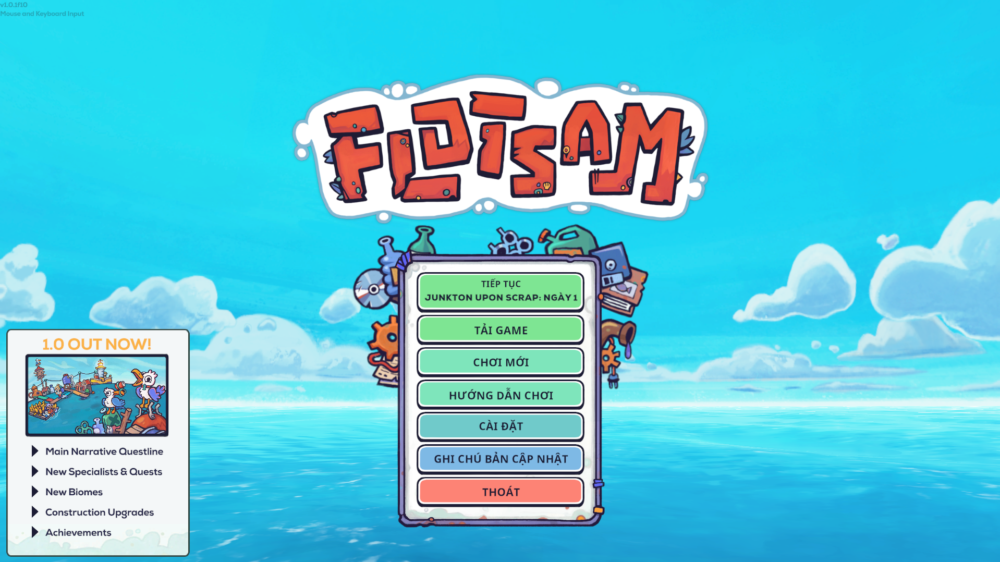
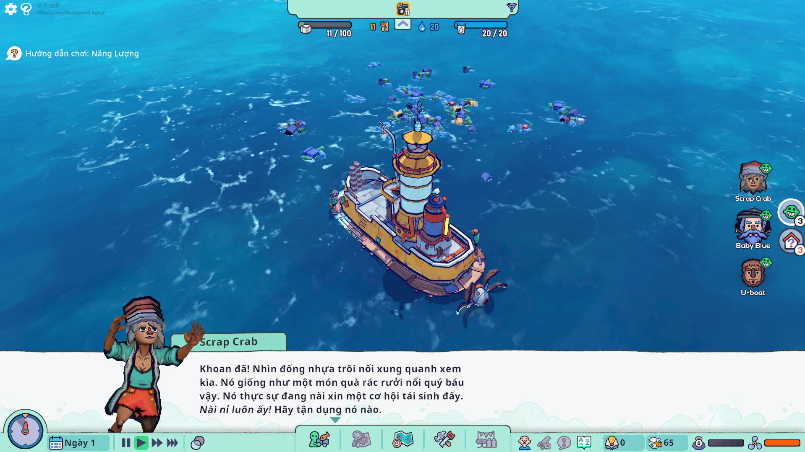

# Flotsam Việt Hóa — Bản Dịch Tiếng Việt (Vietsub / Vietnamese Patch)

<p align="center">
  
  
  
  
  
</p>

Bản **Việt hóa Flotsam** (Bản dịch Tiếng Việt / Vietsub / Vietnamese Localization) hoàn chỉnh 100% (3.263 chuỗi) kèm font tiếng Việt đầy đủ dành cho tựa game sinh tồn **Flotsam (v1.1.0f5)** trên PC (Epic Games Store & Steam).

---

## Lưu ý về bản dịch

> [!NOTE]
> - **Bản dịch chia sẻ MIỄN PHÍ 100%** bởi **[Diiexe](https://github.com/diiexe)**. Nếu bạn phải trả tiền để mua hoặc tải bản Việt hóa này ở bất kỳ đâu thì **bạn đã bị lừa đảo**.
> - **Bản dịch này được dịch bằng AI**, mình làm chủ yếu để tự chơi cá nhân rồi tiện chia sẻ lại cho ai cần. Do không phải dịch thủ công trau chuốt từng câu chữ nên chắc chắn sẽ có chỗ chưa thật sự mượt, dùng được thì dùng, không dùng thì thôi nhé.
> - **Độ an toàn & Miễn trừ trách nhiệm:** Bản Việt hóa chỉ bổ sung ngôn ngữ và phông chữ thuần túy, không đụng chạm mã thực thi của game và mở 100% mã nguồn trên repo này. Tuy nhiên vì là bản mod cá nhân phi thương mại nên mình chỉ chia sẻ theo nguyên trạng, không hỗ trợ bảo hành và không chịu trách nhiệm nếu phát sinh lỗi game, xung đột bản cập nhật hay bất kỳ vấn đề nào liên quan đến tài khoản của bạn.
> - Toàn bộ file văn bản gốc (`raw_text`) và bản dịch tiếng Việt (`vi_text`) được để mở hoàn toàn dạng `.json` trong thư mục `src/` để bất kỳ ai cần tra cứu, lấy dữ liệu hoặc tự sửa lại theo ý mình đều có thể dùng ngay (hướng dẫn chi tiết bên dưới).

---

## Hình ảnh trong game

<p align="center">
  
</p>
<p align="center">
  
</p>

---

## Thông tin phiên bản & Khả năng tương thích

- **Phiên bản trò chơi hỗ trợ:** `v1.1.0f5` (Epic Games Store / Steam, Unity 6 Mono x64).
- **Cơ chế nạp:** Nạp trực tiếp qua asset I2 Localization (`resources.assets`) và font TextMeshPro SDF (`sharedassets0.assets`). Tuyệt đối không can thiệp hay sửa đổi mã nguồn `Assembly-CSharp.dll` và các file màn chơi `level*`.

### Chú thích tương thích

- **Bản cũ hơn v1.1.0f5:** Cấu trúc chỉ mục chuỗi và PathID khác nhau, không nên cài đè vì có thể lệch ngôn ngữ hoặc gây lỗi hiển thị.
- **Bản mới hơn v1.1.0f5:** Nếu Epic/Steam cập nhật tải lại file gốc đè lên bản dịch, chỉ cần chạy lại `Cai_Dat_Viet_Hoa.bat` hoặc chạy `python src/tools/build_patch.py` để đóng gói lại trên file asset mới.

---

## Hướng dẫn cài đặt & Gỡ bỏ (Dành cho người chơi)

### Cài đặt
1. Vào mục **Releases** (bên phải trang GitHub), tải gói **`Flotsam_VietHoa_v1.0.0.zip`** và giải nén ra bất kỳ đâu.
2. Nhấp đúp chạy file **`Cai_Dat_Viet_Hoa.bat`** (script sẽ tự động xin quyền Administrator).
3. Nhập **`1`** (Cài đặt bản Việt Hóa vào game):
   - Script sẽ tự động dò tìm thư mục cài đặt game trên máy (Epic Games / Steam). Nếu đúng thư mục, bạn chỉ cần nhấn **Enter**.
   - Nếu cài game ở thư mục khác, bạn chỉ cần copy đường dẫn thư mục game và dán trực tiếp vào cửa sổ rồi nhấn **Enter**.
4. Mở game và thưởng thức tiếng Việt (script đã tự động sao lưu file gốc vào `Flotsam_Data\backup_goc` và kích hoạt sẵn ngôn ngữ Tiếng Việt).

### Gỡ bỏ (Khôi phục game gốc 100%)
- Chạy file **`Go_Cai_Dat.bat`** (hoặc chạy **`Cai_Dat_Viet_Hoa.bat`** và chọn **`2`**) rồi nhấn **Enter**. Script sẽ tự động khôi phục file gốc từ `backup_goc` và xóa thiết lập ngôn ngữ trong Registry.

---

## Dành cho người muốn lấy Raw Text / Tự sửa bản dịch & Build lại

Toàn bộ dữ liệu văn bản gốc của game và bản dịch đều được để ở định dạng JSON thuần túy (UTF-8), không mã hóa và không nén kín, giúp bạn có thể đọc trực tiếp trên trình duyệt GitHub hoặc tải về bằng nút **`<> Code` -> `Download ZIP`**.

### 1. Giải thích các tệp trong `src/raw_text/` và `src/vi_text/`

| Đường dẫn tệp | Mô tả chi tiết |
| :--- | :--- |
| `src/raw_text/i2languages_terms.json` | **Dữ liệu gốc trích xuất 100% từ game (`resources.assets`)**: Chứa toàn bộ **3.263 khóa (`term`)**, kiểu chuỗi (`type`), cờ (`flags`) và mảng 15 ngôn ngữ gốc của nhà phát triển (tiếng Anh nằm ở vị trí `langs[0]`). Ai cần nghiên cứu hoặc làm bản dịch mới từ đầu có thể dùng trực tiếp file này. |
| `src/raw_text/part_1_en.json` -> `part_8_en.json` | Văn bản tiếng Anh gốc đã được tách nhỏ thành 8 phần (`Key: Tiếng Anh`) để tiện đưa vào các công cụ dịch thuật hoặc AI. |
| `src/vi_text/i2languages_vi.json` | **Từ điển Tiếng Việt tổng hợp (`Key: Tiếng Việt`)**: Đây là file chính được `build_patch.py` nạp vào game. Khi muốn sửa bất kỳ câu dịch nào trong game, bạn chỉ cần mở file này bằng VS Code / Notepad++, bấm `Ctrl + F` tìm câu muốn sửa, lưu lại rồi chạy lệnh build bên dưới. |
| `src/vi_text/part_1_vi.json` -> `part_8_vi.json` | Các phần dịch tiếng Việt tương ứng với 8 phần tiếng Anh gốc. |
| `src/tools/glossary.json` | Bảng thuật ngữ đối chiếu Anh - Việt dùng để giữ tính thống nhất tên công trình, vật phẩm, nhân vật. |

> **Lưu ý khi tự sửa câu dịch:** Giữ nguyên các biến hệ thống nằm trong ngoặc như `{[COMMUNITYNAME]}`, `{0}`, `%ENERGY_PRODUCTION%` và các thẻ định dạng `<color=#...>...</color>`.

### 2. Cơ chế xử lý Font chữ tiếng Việt
- Game sử dụng cả Unity UI Font (`Nexa Heavy`) và TextMeshPro SDF (`NotoSans-Bold SDF`, `NotoSans-Regular SDF`).
- Khi chạy `build_patch.py`, script sẽ tự động:
  1. Ánh xạ các khóa font ngôn ngữ tiếng Việt về `NotoSans-Bold` / `NotoSans-Regular` và thay thế dữ liệu font của `Nexa Heavy` trong `resources.assets`.
  2. Chuyển `NotoSans-Bold SDF` và `NotoSans-Regular SDF` trong `sharedassets0.assets` sang chế độ `Dynamic + MultiAtlas`, nhúng inline texture 256 KB từ `sharedassets0.assets.resS` và đưa lên đầu danh sách fallback của toàn bộ các font SDF trong game.

### 3. Lệnh đóng gói lại sau khi sửa text
Yêu cầu máy có cài Python và thư viện `UnityPy`:
```bash
pip install UnityPy
```
Sau khi sửa xong file `src/vi_text/i2languages_vi.json`, chạy lệnh:
```bash
python src/tools/build_patch.py
```
*(Hoặc truyền kèm đường dẫn thư mục game nếu cài ở vị trí tùy chỉnh: `python src/tools/build_patch.py "D:\Games\Flotsam"`)*.
Script sẽ tự động lấy file gốc sạch từ thư mục game, đóng gói bản dịch mới ra `dist/build/resources.assets` và `dist/build/sharedassets0.assets`, đồng thời chép vào game cho bạn kiểm tra ngay.

---

## Cấu trúc thư mục dự án

```text
Flotsam/
├── dist/                                   # Bộ cài đặt dành cho người chơi
│   ├── Cai_Dat_Viet_Hoa.bat                # Script cài đặt & gỡ bỏ (Menu 2 trong 1)
│   ├── Go_Cai_Dat.bat                      # Script gỡ cài đặt nhanh
│   ├── Huong_Dan_Cai_Dat.txt               # Hướng dẫn ngắn gọn đi kèm bản nén
│   └── SHA256SUMS.txt
├── src/                                    # Mã nguồn mở & dữ liệu văn bản
│   ├── raw_text/                           # Văn bản gốc trích xuất từ game
│   │   ├── i2languages_terms.json          # Toàn bộ 3.263 terms & 15 ngôn ngữ gốc
│   │   └── part_1_en.json .. part_8_en.json
│   ├── vi_text/                            # Văn bản bản dịch Tiếng Việt
│   │   ├── i2languages_vi.json             # File từ điển Tiếng Việt chính để build
│   │   └── part_1_vi.json .. part_8_vi.json
│   └── tools/                              # Công cụ trích xuất, kiểm định & đóng gói
│       ├── build_patch.py                  # Script đóng gói resources & sharedassets0
│       └── glossary.json                   # Từ điển thuật ngữ
├── CHANGELOG.md
├── RELEASE_NOTES.md
└── README.md
```

---

## Tác giả & Bản quyền

- **Bản dịch Tiếng Việt & Bộ công cụ mã nguồn (`src/`, `dist/`):** Thực hiện và phát triển bởi **[Diiexe](https://github.com/diiexe)**. Chia sẻ công khai phi thương mại phục vụ cộng đồng; vui lòng ghi rõ nguồn `Diiexe (github.com/diiexe)` khi chia sẻ hoặc đăng tải lại.
- **Bản quyền trò chơi gốc:** Toàn bộ hình ảnh, âm thanh và tài sản trò chơi gốc thuộc về nhà phát triển **Pajama Llama Games**. Vui lòng mua game bản quyền trên Epic Games Store hoặc Steam để ủng hộ tác giả.
